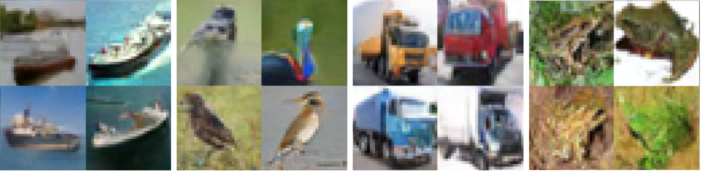

# Experiments on the U-Net Bottleneck in Flow Matching
## An Empirical Deep Learning Study

---

[Read the full paper (PDF)](_docs/full_paper_pdf.pdf)

### Abstract
U-Net architectures are widely used as the neural networks underlying modern image-generation models. Though commonly used, their internal mechanics are not fully understood yet. This project investigates the impact of interfering with the bottleneck, the lowest-resolution stage of the U-Net, and the resulting changes in selected metrics and image quality. I use a Flow matching training formulation, which is a state-of-the-art approach for training generative models.

On class-conditional CIFAR-10 with a 10.85M-parameter U-Net, I evaluate two interventions: (1) Bottleneck Input Perturbation (b-IP), Gaussian noise injected into the pre-bottleneck activations using a custom time-dependent, standard-deviation-weighted schedule; and (2) a KL-divergence to unit-Gaussian loss penalty on the post-bottleneck activations.

Both improve FID-50k in this setting: an 8.33\% improvement for b-IP ($\gamma_0 = 0.2$) and a 6.48\% improvement for the KL penalty ($\beta = 0.5$) relative to the base model, with every seed of each best configuration outperforming every base-model seed, whereas standard network-input perturbation does not improve FID.

The experimental results do not fully support the hypothesized mechanisms to explain the gain: neither intervention measurably reduces a proxy metric for exposure bias, bottleneck noise does not consistently change the model's partial derivatives, and the KL penalty does not enlarge the bottleneck's effective receptive field. Consequently, the cause of the FID gains remains an open question that I narrowed down using selected metrics.

The results come from mini-scale models trained for 400 epochs with a constant learning rate and are mostly single-seeded. Because experiments were restricted to the network input and the bottleneck, they do not establish how the effect generalizes across other intermediate resolution stages of the U-Net. All code used for training, analyzing and evaluating is public.

---

All training, sampling and evaluation code used in the paper can be found here.

All model weights are in the outputs folder in this google drive link: https://drive.google.com/drive/folders/1Vx8VBGTXRCvC12-4gMRCAawB45DCY_sJ?usp=drive_link

Unzip that folder into the project root to load and use those models.

### Setup/Usage

`pip install -r requirements.txt`

For inference, use SAMPLING_MASTER.py by running the project as a module:
`python -m main.SAMPLING_MASTER`
You can choose a model suffix at the top of the file.

